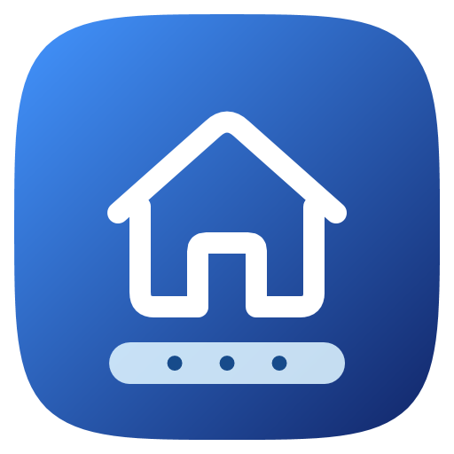

# One TaskBar



A per-user Windows dock, app launcher, and control center with live backdrop blur. Written in C# and WPF, with an independent recovery watchdog. [한국어](README-ko.md)

## Install

Download **OneTaskBar-Setup.exe** from [Releases](https://github.com/Bundelldebug/OneTaskBar/releases/latest), open it, and select Install. It installs for the current user, offers startup and desktop-shortcut choices, and launches the dock. Normal installation and use do **not** require administrator rights. No certificates, machine policies, or system executables are modified.

- Windows 11 x64 is the tested platform. Windows 10 2004+ x64 with .NET Framework 4.8 is a compatibility target; some shell integration depends on the Windows build. ARM64/native x86 builds are not provided.
- The initial release is not code-signed; Windows may show an unknown-publisher/SmartScreen prompt. Verify the release checksum. The installer does not disable Windows protection.
- App: `%LOCALAPPDATA%\OneTaskBar\App`; settings: `%LOCALAPPDATA%\OneTaskBar\Data`.
- Uninstall through Windows Settings → Apps → One TaskBar. Settings are retained. The Windows taskbar is restored when the app exits.
- For a portable run, extract the entire ZIP and open `OneTaskBar.exe --desktop`. To install that ZIP, run `Install.ps1` with Windows PowerShell. The app still stores preferences in LocalAppData.

## Features

- Separate app and status capsules; original Windows/app icons, Windows system font, seconds on the clock, running indicators, and drag-to-reorder pins.
- Rounded, antialiased surfaces using layered WPF alpha and a matching DirectComposition clip. Blur stays steady while app/search contents animate.
- Compact app drawer and launcher search, capped at 720 × 680 DIP: apps, Windows settings, local files/images, Korean initial consonants, and removable recent searches. Type directly in the app drawer; active IME composition finishes before the transition.
- A One Taskbar Start menu precedes the app drawer: search, paged pinned apps, recent files, user/document folders, settings and lock/sleep/shutdown/restart. Start pins and their drag order are saved separately from dock pins; app context menus offer both choices. Dragged tiles follow the pointer while neighbors animate into place. “All apps” opens the existing drawer. The Start page is capped at 940 × 620 DIP and uses the same glass as quick settings.
- Start and All apps each support app folders, folder renaming and child drag order; use tile centers to group and edges to reorder. Folder extraction preserves apps. Start, drawer and dock layouts are saved separately. The Phone Link pane uses the installed native Start companion card and collapses on narrow displays.
- In custom Start-key mode, a solo physical Windows press stays out of the native shell from key-down, avoiding the native dim/undim transition. Windows chords are replayed in modifier/key order; native Start-key mode remains available.
- Independent choices for Windows/custom quick settings, notifications, keyboard Start, and search. Windows shortcuts continue to work with the solo Start-key option.
- Touch panning and fractional touchpad scrolling; discrete wheel scrolling uses a short transition.
- System volume, brightness where supported, radio/device controls, media transport and centered artwork, battery/power mode, and theme toggle.
- Ten quick toggles read back actual state: mute, dark mode, Do Not Disturb, power efficiency, keep screen awake, Wi-Fi, Bluetooth, dock animations, startup and slider scrolling. Unsupported hardware controls are disabled or hidden. Power efficiency selects the Windows performance overlay; it is not a separate Energy Saver implementation. Keep-awake lasts only while the app is running and still allows manual sleep.
- A bottom-left Media player follows active Windows media sessions. Its 44-DIP capsule fits the title up to the actual right status capsule's width (282 DIP maximum), keeps artwork and text left aligned, scrolls longer titles, and expands into playback/seek controls when the media app supports them. Artwork supplies the background color, adjusted for readable white text. Crowded displays reserve space in the same row and narrow the title; the dock's existing overflow capacity applies without changing saved app order.
- Missing radios, Samsung applications, unsupported brightness devices, and absent batteries are handled without placeholder applications. Desktop users can hide the battery slot or manually show 1–9999 W; this value is **not a measurement**.
- Charging status updates immediately on AC connection; the battery capsule expands once per cable connection. Startup does not simulate a plug event.
- Settings → Media player offers default or large-cover expansion; settings → Charging sound selects and previews your own local audio file. Both new options default off.
- The button immediately right of Search opens Windows Task view for switching desktops. In launcher Search, use arrows to select results and Enter to open them. App menus in Start, All apps and Search offer Run as administrator for desktop executables/shortcuts; Windows controls the elevation prompt.
- App context menus include Task Manager. Toggle animations, blur, hover, startup, indicators, and recovery in settings.

## Recovery and shortcuts

| Shortcut | Action |
| --- | --- |
| Ctrl+Alt+H | One TaskBar settings |
| Ctrl+Alt+Q | Quick settings |
| Ctrl+Shift+Tab+1 | Force-exit **One TaskBar itself** and restore the Windows taskbar |

The emergency shortcut is enabled by default and can be disabled in settings. It is monitored by `OneTaskBar.Guard.exe`, independent of the WPF UI thread, so it also works if the UI stops responding. It validates the process path, PID, and start time; it does not terminate the foreground application. The same watchdog attempts restoration after a crash or external termination. It cannot intercept keys on the Windows secure desktop or after the watchdog itself is terminated.

## Notifications and optional integrations

The standard EXE installer defaults to the **Windows notification center**, which works without package registration or notification-reading permission. The custom center contains notifications without a calendar.

Open One TaskBar settings → Windows notification connection to register its optional local identity and request access inside the app. Windows may require a one-time administrator approval for registration and always controls notification consent. Existing registration is reused on normal launch and login. The identity is an **unsigned local-test package**, not a production-signed MSIX; it is optional and is not silently registered by Setup. See [notification setup and limits](docs/NOTIFICATIONS.md). Native Windows notifications remain available.

With notification access allowed, **One Taskbar notification popups** replaces supported Windows toast banners with up to three rounded glass cards. Popups do not take keyboard focus; closing a card keeps its notification in history. Actual Windows banner content is matched to fresh listener entries, so existing history and history-only updates are not replayed. Clicking uses the original Windows toast action, protocol or registered callback. Notifications without a direct route are matched against their native history card; an ambiguous/unavailable match opens the native center rather than launching the sender app with guessed arguments. The expiry timer stops when the stack is empty. This optional shell integration is Windows-build dependent; see the notification guide for fallback and recovery behavior.

Samsung Settings / device-connection buttons use applications and logos already installed on the PC; those applications are not bundled. Compatible devices show Samsung performance choices in Battery and power. Direct selection is enabled only if the installed OEM service accepts the client. On this development PC the service rejects unsigned external clients, so profiles remain visible with an explanation and the explicit Samsung Settings button remains available. Selecting a profile never launches/automates the OEM UI. No firmware or mirrored registry performance value is directly written. An optional, pre-existing Windhawk charging companion is paused while the dock owns the desktop and resumed on exit. Windhawk is not required for the dock or installed by Setup.

## Build and verify

No NuGet restore or SDK download is needed on a Windows desktop with .NET Framework 4.8, Windows PowerShell 5.1, and the OS WinMetadata files.

```powershell
powershell.exe -NoProfile -ExecutionPolicy Bypass -File .\Build.ps1
powershell.exe -NoProfile -ExecutionPolicy Bypass -File .\tools\BuildInstaller.ps1 -SkipBuild
```

Output: `dist/OneTaskBar.exe`, `release/OneTaskBar-Setup.exe`, portable ZIP, and SHA256SUMS. The installer embeds an explicit payload allowlist, excluding personal state, developer MSIX packages, logs, and reference media. The original vector icon can be regenerated with `tools/MakeAssets.ps1`.

```powershell
$env:ONE_TASKBAR_DATA = Join-Path $PWD '.qa-data'
Start-Process .\dist\OneTaskBar.exe '--self-test' -Wait
Start-Process .\dist\OneTaskBar.exe '--ui-probe --optimized' -Wait
Start-Process .\dist\OneTaskBar.exe '--typing-probe' -Wait
Start-Process .\dist\OneTaskBar.exe '--nowbar-probe' -Wait
Start-Process .\dist\OneTaskBar.exe '--quick-feature-probe' -Wait
Start-Process .\dist\OneTaskBar.exe '--recovery-probe' -Wait
```

Interactive probes require an unlocked desktop and focus their own test windows. Test results stay in the data directory; they are not uploaded. See [VALIDATION.md](VALIDATION.md) for measured results and limits.

## Privacy and licensing

No telemetry, account, or background web service is required. Search runs locally. Preferences, recent queries, shell pin caches, and diagnostic logs stay in the data directory. The custom notification center accesses notification data only after Windows permission. An app or document you choose to open may use its own network services.

YouTube high-resolution covers are optional and off by default. When enabled, only the exact playing Samsung Browser title is matched in that browser's current local History profile. A unique video ID is used to request a public cover from `i.ytimg.com`; no title, cookies or history rows are sent. Ambiguous matches are rejected. Each track is resolved once, with bounded database time, download size and two CDN image-size attempts. Single-video consent can be limited to that track instead of enabling the general option. Native artwork keeps its source detail up to 1280 pixels; background images remain bounded separately. A source that supplies only a tiny image may still look soft when no matching high-resolution cover is available.

Code and the original One TaskBar icon are under the [MIT license](LICENSE). [Third-party notices](THIRD_PARTY_NOTICES.txt) include the Liquid Dock reference. This repository contains no Samsung APK, extracted launcher artwork, wallpapers, fonts, or user screenshots/recordings. Installed third-party logos are read at runtime and remain their owners' property. This is an independent project and is not affiliated with Microsoft or Samsung. Open-source licensing does not guarantee that no third party will ever make a copyright or trademark complaint.

## 8.5.6

- Ctrl+Shift-click an app in the dock, Start, All apps, Search or overflow to request Windows elevation for supported desktop targets. Packaged apps and settings URIs do not support this route; normal Windows consent applies.
- Drag a dock app toward the left/right work area for a split or toward the center for a popup-sized window. Animated previews, Escape/bottom cancellation, monitor-aware placement and complementary placement of the previous ordinary window are included. Settings → Desktop can disable window dropping while retaining dock reordering. Windows that prohibit resizing cannot be split.
- Bluetooth details show native device-type icons, connection status, registered devices and new devices. Selecting a registered device opens management options; removal requires explicit selection and confirmation.
- Search recommends recently launched/activated apps rather than fixed pins. Only up to 64 app identities and timestamps are saved locally; documents and window titles are excluded. Writes are debounced after activity.
- Temporary preview/notice content and live blur fade together and pass pointer input through both HWNDs. Drag cancellation restores focus; monitor DPI is cached during gestures and temporary timers/input registrations are released.

## 8.5.5

- Same-app notifications collapse into one capsule showing the latest content, time and count. Expand/collapse transitions animate; top-right popups slide/fade with their blur. Individual actions/group clearing and retained expansion survive arrivals.
- Wi-Fi and Bluetooth details rescan on every open, with an animated refresh icon. Wi-Fi waits for the WLAN completion event; Bluetooth uses a finite nearby-device watcher. Closing a panel cancels discovery, stops the spinner and ignores late results; failures preserve the previous list.
- In Quick settings → Edit layout, drag the toggle group's curved bottom-right handle. Columns (1–4) and rows (1–5) vary independently, allowing all 20 combinations, including vertical groups. The center Edit button opens the full reorder grid; folding restores the saved shape. Focus the handle to resize with arrow keys, or press Escape during a drag to restore the prior shape.
- Compact Media player stays on the dock baseline, narrowing to a 44-DIP artwork-only circle when needed; space is restored when playback ends. Folding keeps the visible native host's origin stable instead of rebasing its layered bitmap on the last frame, preventing a momentary flash. A hidden/reopened player starts with a compact host. Morph timing runs only during transitions; redundant synchronous GDI repaint was removed.
- Crowded docks keep earlier pins and place remaining apps behind a final `…`. Hover or click opens a scrollable popup above the dock, with launch/window selection and app context menus. Outside clicks dismiss it; saved app order is unchanged.
- Dock dragging resolves destinations against saved slots rather than moving neighbors, with boundary hysteresis and no animation restart for equivalent final orders. Rapid reversals and pin-boundary crossing settle continuously.
- A new Ethernet-jack icon follows the active connection profile, including PCs with both Wi-Fi and Ethernet. Network change events invalidate the cached route.
- Addresses GitHub #1's auto-hide report: state changes target the real taskbar HWND and wait for confirmation. Dock capsules, icons, blur and Media player fade/slide together, including interrupted reversal. Interaction grace and capsule-gap hit areas reduce premature hiding. Expanded media holds the dock open; outside clicks collapse and hide it. Normal placement balances the gaps against the actual reserved work area.
- Packaged apps prefer their taskbar's unplated target-size assets over large tile artwork, sharing one icon cache entry per app ID. Installed native assets were checked; the reporter's Store edition of Spotify is not installed on this PC.
- Samsung profiles use four circular buttons in one capsule: Silent, Quiet, Optimized, High performance. The current mode is highlighted; high performance displays the OEM maximum-fan state, or an explicit unavailable state. Transient read failures retain choices. The OEM client-signature limitation described above remains; automatic opening of Samsung Settings was removed.
- Clicking artwork in quick settings or either expanded media style animates the transition and opens the exact session's media app.
- Per-network Wi-Fi icons show signal and supported Wi-Fi generation, with connected/security status. A top Instant Hotspot entry hands off to Windows when Phone Link is installed. Other providers' hotspots cannot be enumerated/connected directly through the public API, so device selection still occurs in Windows.
- Start, All apps and Search app menus include Windows app removal. Win32 elevation resolves registered shortcuts/executables and preserves arguments even when Get-StartApps supplies only an app ID; unsupported packaged-app elevation stays disabled. Keyboard selection uses the smooth rounded highlight without the default dotted focus adorner.
- Web apps prefer their exact AppUserModelID's dedicated shortcut/window icon over browser executable icons. The installed PocketRisu shortcut and artwork were verified.
- Unchanged notification stacks, clock labels and spinner geometry are reused. Hidden discovery, animation timers and composition resources are released; resource measurements and hardware limits are in VALIDATION.md.

## 8.5.4

- Fixes menu/dock placement across monitor origins and DPI scales. Each HWND reaches the destination monitor before DPI is read; initial dock placement waits until all three windows are ready.
- Fixes icons disappearing after rapid fullscreen/capture transitions. Dock visibility changes cancel the pending content fade, and rebuilding a hidden dock no longer shows its status capsule.
- Follows the real Windows taskbar auto-hide setting instead of forcing that setting during startup. The same option is available in One TaskBar settings. A two-physical-pixel bottom edge reveals the hidden dock through mouse events, with no permanent fast polling timer. Open menus, previews and media controls keep it visible.
- Releases the dock's work-area reservation while auto-hidden, avoids doubling the native taskbar reservation when shown, and preserves user setting changes on exit/crash. See VALIDATION.md for actual/synthetic monitor coverage and resource results.

## 8.5.3

- Adds `tools/Test-ReleaseDefender.ps1` for pre-publication scans of the app, recovery helper, Setup and portable archive. It requires active protection, unchanged file hashes and no new matching detections. It does not change security exclusions or protection settings. Scan results are specific to those files and installed definitions. Trusted code signing requires a separate publisher certificate; Defender results and SmartScreen reputation are distinct. See [Microsoft's developer FAQ](https://learn.microsoft.com/en-us/defender-xdr/developer-faq) and [file submission portal](https://www.microsoft.com/en-us/wdsi/filesubmission/).
- Adds Task view beside dock Search, spatial keyboard navigation and Enter in launcher Search, and administrator launch in Start/All apps/Search app menus. IME composition and the query's normal caret controls are preserved; the dock menu does not show elevation.
- Start and All apps support folders, naming, child order, extraction and animated reordering. Each layout is independent of dock pins; new installs append without reshuffling existing folders.
- Start gains a responsive Phone Link pane from the installed native companion card, with connection/battery details and generic message/call/photo/file shortcuts. It refreshes on opening, with no hidden polling; unavailable metadata shows a connect state.
- Battery and power shows supported Samsung performance profiles only on compatible devices with Samsung Settings installed. Selection uses the signed OEM app's controls, with the original performance page as fallback when automation is unavailable. Firmware services and mirrored registry values are not written directly.
- Notification icons fall back to installed app logos. Available native app-logo overrides and large images appear in both the center and banners. Missing images leave no placeholder or empty image column; picture reads reuse local assets/cache without downloading remote images.
- Adds a custom charging sound file picker and preview. It defaults off, plays once on a new AC connection and does not play merely because the app starts plugged in.
- Media player offers an optional large-cover expansion with controls below the artwork, preserving the default compact player. Missing covers omit the large area. Real Windows lock-screen replacement is outside the supported desktop app APIs.
- Renames the capsule feature to Media player. Covers preserve native resolution up to 1280 pixels, with a separate opt-in Samsung Browser/YouTube high-resolution source for tiny native thumbnails.
- Renames custom Start and popup settings to One Taskbar. Hidden panels release after 20 seconds, detail-page timers stop while hidden, and the icon cache is bounded to 48 entries with 160-pixel assets. No forced GC or working-set trim is used; see validation for measured memory and CPU.

## 8.5.2

- Adds a compact One Taskbar Start page with search, pinned apps, recent files, All apps and power controls. Start pins are independent of dock pins; drag to reorder them with animated movement and persistent positions.
- Buffers solo Windows-key presses before the native shell sees them, avoiding its dim/undim flash while preserving Windows-key chords and the optional native Start mode.
- Clips both Media player native input regions to the visible capsule, restoring clicks above and beside it in collapsed and expanded states.
- Adds optional One Taskbar notification banners with no focus stealing. Actual native-toast matching preserves silent history updates, Do Not Disturb and per-app banner decisions.
- Opens the original notification action through the native toast, protocol, registered callback or exact native history card. Missing or ambiguous matches reveal Windows notification history instead of merely launching the sender app.
- Keeps cached input bounds, bounded background work and event-driven recovery. The final battery/media-active resource sample averaged 0.0517% main CPU and 0.0000% helper CPU; see validation for memory and measurement limits.

## 8.5.1

- Caps the collapsed Media player at the right status capsule's width and keeps the thumbnail and title left aligned, including short titles.
- Removes the playback-state icon from the collapsed capsule, leaving artwork and title.
- Reduces the active quick-settings player from 188 to 140 DIP. Quick settings and expanded Media player show artwork behind a dark translucent overlay for readable text.
- Artwork surfaces are frozen, shared and bounded to 640 pixels, with weak caching so past covers can be collected. No live artwork blur or per-refresh decoding is added.
- Same-title artwork events replace stale thumbnails. Two bounded retries after a track change handle late covers; identical image bytes reuse their decoded bitmap, and transient failures retain only the current track's cover.
- Wheel/trackpad slider adjustments in quick settings default off. Enable them with the slider-scrolling quick toggle or app setting; otherwise scrolling continues through the panel.
- A thin black dock divider separates pinned apps on the left from running-only apps on the right. Dragging across it saves pin/unpin changes. The dragged icon follows the pointer while neighboring icons slide into place; cancellation restores the layout.
- Routine updates increment the patch number only; major and minor versions change at the owner's request.

## 8.5.0

- Fixes the delayed one-core CPU saturation in the packaged recovery helper. A hash-verified copy runs outside the notification package, and startup checks its readiness and unpackaged identity. Keyboard and owner-exit events replace the 20-ms polling loop.
- Idle dock updates drop to 1 Hz on battery (0.5 Hz in fullscreen); display-off work sleeps for up to 30 seconds. Direct volume, brightness and foreground events remain responsive, and opening panels retains a faster cadence.
- Volume, media and notification changes use callbacks; device, brightness, app and pinned-item fallback scans run less often. Battery-powered title overflow scrolls once, then rests until hovered. Stationary title pauses no longer redraw continuously.
- The previous 0.5.5 short CPU samples did not detect the delayed helper regression. Resource measurements and test limits are recorded in [VALIDATION.md](VALIDATION.md); a full battery discharge comparison has not been performed.

## 0.5.5

- Live DWM window previews with enlarged image content, monitor-aware pagination and released thumbnail handles.
- One shared media player in quick settings and Media player, including default output-device name and an icon button for switching outputs. Idle media becomes a slim capsule.
- In-app Windows notification connection, Do Not Disturb toggle, calendar-free notification panel and mutually exclusive quick/notification panels.
- Softer low-volume/brightness shapes, matched blur during transitions, signal-aware Wi-Fi arcs, click-away context menus and Media player collapse, and white battery numbers.
- Background work uses two reusable EcoQoS workers; Windows selects efficient cores on supported hybrid CPUs. No hard CPU affinity is imposed. Icons decode on entering the viewport, media metadata follows change events, and fallback polling is reduced. UI/animation work and urgent keyboard feedback retain their normal execution paths.
- Battery operation lowers the general UI pulse from 10 to 5 Hz, independently of animation frames and input callbacks. This reduces periodic work; battery-runtime gains have not been measured.
- Fixes the recovery helper's undispatched STA messages that could saturate a core and leave helpers behind after restart. The helper now uses a sleeping native owner wait with 20-ms emergency-key checks, avoids window-message and file-watcher traffic, and rejects duplicates.
- Setup resolves physical executable paths for virtualized hosts and skips identical files during updates.

## 0.5.2

Adds the artwork-colored Media player with real media-session controls, adaptive title width and marquee overflow. Expansion and collapse animate the capsule inside a fixed native host, keeping text layout cached and avoiding repeated native window resizing and backdrop placement. Transparent space outside the capsule passes clicks through; the bar stays out of Alt+Tab.

Quick settings, connection details, notifications, app drawer and search share the gray live-glass palette. App/search panels use compact bounds and continuous content transitions. Quick settings contains actual stateful toggles, a plain settings glyph and a power menu with restart, shutdown, sleep and lock.

## Earlier changes

### 0.4.0

The dock button can independently open the app drawer or Windows Start. Connected PHY data drives Wi-Fi generation badges (4/5/6/7); unknown/offline connections have no generation badge. Clicking the foreground application minimizes it, with a visible icon bounce. Panels now use a light frosted material and original monochrome settings symbols. Brightness uses Windows power notifications, while the dedicated Explorer OSD is replaced only when the custom HUD is available.

Known issue: native Start button invocation is not yet verified on the development PC; automated invocation opens SearchHost although physical Ctrl+Esc opens Start. The app drawer remains the default.

0.4.2 adds retained dock cells with animated capsule growth/shrink, icon entry/exit and stable launch ordering (newest on the right), preserving manual moves. The gray control center has a more transparent neutral tint and a shutdown/sleep/lock menu. Native OSD opacity is prepared before presentation and restored on exit or watchdog recovery.

0.4.3 keeps every existing dock slot fixed when its app starts or stops; only new entries append on the right. Quick settings uses a stronger translucent black tint over the live backdrop, with one shared white for enabled radio buttons, theme/audio buttons and slider fills.
